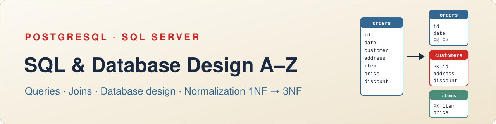
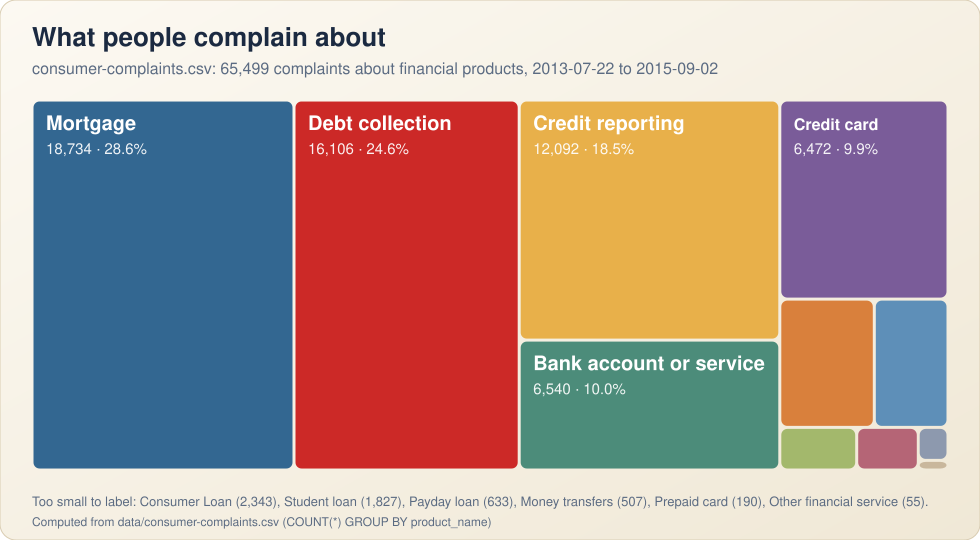
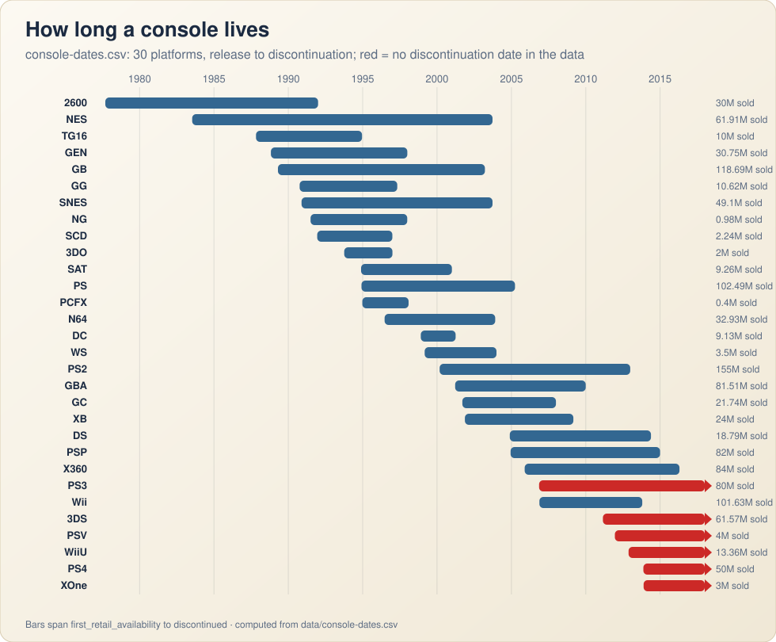
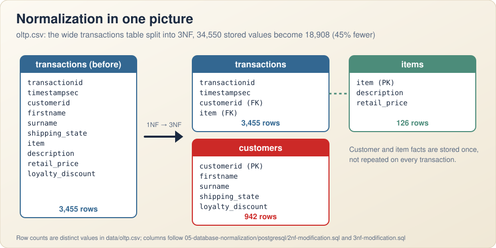

<p align="center">
  <a href="https://www.postgresql.org/"></a>
  <a href="https://www.microsoft.com/sql-server"></a>
  <a href="https://www.pgadmin.org/"></a>
  <a href="https://en.wikipedia.org/wiki/Database_normalization"></a>
  <a href=".github/workflows/pg-run.yml"></a>
  
  
</p>

The same SQL course, **solved twice**: every lesson has a **PostgreSQL** version (pgAdmin) and a **SQL Server** version (SSMS), so you can see which parts of SQL are universal and where the dialects differ. 72 short scripts (37 PostgreSQL, 35 SQL Server) take you from your first `SELECT` through joins and database creation to normalizing a wide table into 3NF, on eight real datasets.

> *"Same question, two dialects: 72 scripts, 2,298 lines of annotated SQL, from `SELECT` to third normal form."*

---

## Course map

| # | Section | PostgreSQL | SQL Server | What you work on |
|:-:|---------|:---------:|:----------:|------------------|
| 00 | [Quickstart](00-quickstart/) 🎯 | 1 | – | CREATE, INSERT and GROUP BY in one small script (standard SQL) |
| 01 | [SQL Basics](01-sql-basics/) 🔎 | 5 | 7 | SELECT, WHERE, LIKE on 65,499 complaints |
| 02 | [Intermediate SQL](02-intermediate-sql/) 🔧 | 10 | 8 | ALTER, UPDATE, dates, strings on game sales |
| 03 | [Advanced SQL](03-advanced-sql/) 🔗 | 11 | 11 | INNER, LEFT, FULL OUTER, CROSS joins |
| 04 | [Database Creation & Design](04-database-creation-and-design/) 🏗️ | 6 | 4 | Create, INSERT, ALTER, DROP on `movies` |
| 05 | [Database Normalization](05-database-normalization/) 🧩 | 5 | 5 | 1NF → 3NF on 3,455 transactions |
| – | [Data](data/) 📂 | | | 8 CSV files |
| – | [Upload guides](docs/upload-guides/) 📘 | | | how to import a CSV in pgAdmin and SSMS |

---

## Learning path

```
 SQL Basics ──► Intermediate ───────► Advanced ───────► Create a database ──► Normalization
  SELECT         ALTER, UPDATE         INNER / LEFT       CREATE, INSERT        1NF  find duplicates
  WHERE, LIKE    ORDER BY, dates       FULL OUTER         ALTER, DROP           2NF  split customers
  wildcards      CAST, strings         CROSS JOIN         DELETE                3NF  split items
```

Sections 1 to 3 teach you to **ask** a database questions, Section 4 teaches you to **build** one, and Section 5 shows how to **fix** a badly designed one.

---

## The data tells the story

All three pictures are computed from the CSV files in [`data/`](data/).



Section 1 runs on 65,499 consumer complaints. Mortgages and debt collection together are more than half of them, which is exactly the kind of question `GROUP BY` and `COUNT(*)` answer in one line.



Section 2 uses release and discontinuation dates, where `DATEDIFF` (SQL Server) and `AGE()` (PostgreSQL) turn two date columns into a lifespan. The NES stayed on sale for about 20 years.



Section 5 takes a wide table of 3,455 transactions and splits it, step by step, so that every customer and every item is stored once.

---

## Script tour

<details>
<summary>🔎 <b>SQL Basics</b> · 🐘 PostgreSQL (pgAdmin) (5 scripts)</summary>

| Script | Topic |
|---|---|
| [`00-first-database-create-new-table-and-import-dataset.sql`](01-sql-basics/postgresql/00-first-database-create-new-table-and-import-dataset.sql) | First database create new table and import dataset |
| [`basics-select-from-where-filter-practice-or-and.sql`](01-sql-basics/postgresql/basics-select-from-where-filter-practice-or-and.sql) | Basics select from where filter practice or and |
| [`select-from-where-filter-ca-tx-mortgage.sql`](01-sql-basics/postgresql/select-from-where-filter-ca-tx-mortgage.sql) | Select from where filter CA, TX, mortgage |
| [`select-from-where-filter-equals.sql`](01-sql-basics/postgresql/select-from-where-filter-equals.sql) | Select from where filter equals |
| [`where-like-upper-lower-wildcards.sql`](01-sql-basics/postgresql/where-like-upper-lower-wildcards.sql) | Where like upper lower wildcards |

</details>

<details>
<summary>🔎 <b>SQL Basics</b> · 🪟 SQL Server (SSMS) (7 scripts)</summary>

| Script | Topic |
|---|---|
| [`00-first-database-create-new-table-and-import-dataset.sql`](01-sql-basics/sql-server/00-first-database-create-new-table-and-import-dataset.sql) | First database create new table and import dataset |
| [`first-query-select-from.sql`](01-sql-basics/sql-server/first-query-select-from.sql) | First query select from |
| [`select-count-where.sql`](01-sql-basics/sql-server/select-count-where.sql) | Select count where |
| [`select-from-where-filter-equals.sql`](01-sql-basics/sql-server/select-from-where-filter-equals.sql) | Select from where filter equals |
| [`select-from-where-like-and-wildcard.sql`](01-sql-basics/sql-server/select-from-where-like-and-wildcard.sql) | Select from where like and wildcard |
| [`select-from-where-like-and-wildcardss.sql`](01-sql-basics/sql-server/select-from-where-like-and-wildcardss.sql) | Select from where like and wildcardss |
| [`select-from-where-logical-and-or.sql`](01-sql-basics/sql-server/select-from-where-logical-and-or.sql) | Select from where logical and or |

</details>

<details>
<summary>🔧 <b>Intermediate SQL</b> · 🐘 PostgreSQL (pgAdmin) (10 scripts)</summary>

| Script | Topic |
|---|---|
| [`00-create-database-new-table-console-games.sql`](02-intermediate-sql/postgresql/00-create-database-new-table-console-games.sql) | Create database new table console games |
| [`00-create-new-table-console-dates.sql`](02-intermediate-sql/postgresql/00-create-new-table-console-dates.sql) | Create new table console dates |
| [`alter-table-add-new-column-update-set-where-filter.sql`](02-intermediate-sql/postgresql/alter-table-add-new-column-update-set-where-filter.sql) | Alter table add new column update set where filter |
| [`altering-table-add-new-column-update-and-set-new-formula.sql`](02-intermediate-sql/postgresql/altering-table-add-new-column-update-and-set-new-formula.sql) | Altering table add new column update and set new formula |
| [`order-by.sql`](02-intermediate-sql/postgresql/order-by.sql) | Order by |
| [`select-age-order-by.sql`](02-intermediate-sql/postgresql/select-age-order-by.sql) | Select age order by |
| [`select-cast-order-by-to-date.sql`](02-intermediate-sql/postgresql/select-cast-order-by-to-date.sql) | Select cast order by to date |
| [`select-from-where-date-filter.sql`](02-intermediate-sql/postgresql/select-from-where-date-filter.sql) | Select from where date filter |
| [`select-length-left-right-reverse.sql`](02-intermediate-sql/postgresql/select-length-left-right-reverse.sql) | Select length left right reverse |
| [`select-where-is-null.sql`](02-intermediate-sql/postgresql/select-where-is-null.sql) | Select where is null |

</details>

<details>
<summary>🔧 <b>Intermediate SQL</b> · 🪟 SQL Server (SSMS) (8 scripts)</summary>

| Script | Topic |
|---|---|
| [`00-create-2-table-update-and-set-null.sql`](02-intermediate-sql/sql-server/00-create-2-table-update-and-set-null.sql) | Create 2 table update and set null |
| [`00-import-data-create-new-table.sql`](02-intermediate-sql/sql-server/00-import-data-create-new-table.sql) | Import data create new table |
| [`alter-add-column-update-set.sql`](02-intermediate-sql/sql-server/alter-add-column-update-set.sql) | Alter add column update set |
| [`datediff-year-month-order-by-desc.sql`](02-intermediate-sql/sql-server/datediff-year-month-order-by-desc.sql) | Datediff year month order by desc |
| [`dates-datepart-or.sql`](02-intermediate-sql/sql-server/dates-datepart-or.sql) | Dates datepart or |
| [`dates.sql`](02-intermediate-sql/sql-server/dates.sql) | Dates |
| [`left-right-reverse-with-varchar.sql`](02-intermediate-sql/sql-server/left-right-reverse-with-varchar.sql) | Left right reverse with varchar |
| [`order-by-asc-desc.sql`](02-intermediate-sql/sql-server/order-by-asc-desc.sql) | Order by asc desc |

</details>

<details>
<summary>🔗 <b>Advanced SQL</b> · 🐘 PostgreSQL (pgAdmin) (11 scripts)</summary>

| Script | Topic |
|---|---|
| [`00-create-4-brand-new-tables-import-data.sql`](03-advanced-sql/postgresql/00-create-4-brand-new-tables-import-data.sql) | Create 4 brand new tables import data |
| [`advanced-cross-join.sql`](03-advanced-sql/postgresql/advanced-cross-join.sql) | Advanced cross join |
| [`advanced-gpt-complex-joins.sql`](03-advanced-sql/postgresql/advanced-gpt-complex-joins.sql) | Advanced GPT complex joins |
| [`advanced-gpt-joins.sql`](03-advanced-sql/postgresql/advanced-gpt-joins.sql) | Advanced GPT joins |
| [`cleaning-up-my-join.sql`](03-advanced-sql/postgresql/cleaning-up-my-join.sql) | Cleaning up my join |
| [`complex-join.sql`](03-advanced-sql/postgresql/complex-join.sql) | Complex join |
| [`first-left-join.sql`](03-advanced-sql/postgresql/first-left-join.sql) | First left join |
| [`full-outer-join.sql`](03-advanced-sql/postgresql/full-outer-join.sql) | Full outer join |
| [`inner-join.sql`](03-advanced-sql/postgresql/inner-join.sql) | Inner join |
| [`joining-multiple-fields.sql`](03-advanced-sql/postgresql/joining-multiple-fields.sql) | Joining multiple fields |
| [`tips-and-tricks-joins-gpt-alternative.sql`](03-advanced-sql/postgresql/tips-and-tricks-joins-gpt-alternative.sql) | Tips and tricks joins GPT alternative |

</details>

<details>
<summary>🔗 <b>Advanced SQL</b> · 🪟 SQL Server (SSMS) (11 scripts)</summary>

| Script | Topic |
|---|---|
| [`00-import-data-create-4-tables-raw.sql`](03-advanced-sql/sql-server/00-import-data-create-4-tables-raw.sql) | Import data create 4 tables raw |
| [`advanced-join-with-gpt-multiple-fields-eng.sql`](03-advanced-sql/sql-server/advanced-join-with-gpt-multiple-fields-eng.sql) | Advanced join with GPT multiple fields ENG |
| [`advanced-join-with-gpt-multiple-fields-ru-eng.sql`](03-advanced-sql/sql-server/advanced-join-with-gpt-multiple-fields-ru-eng.sql) | Advanced join with GPT multiple fields RU/ENG |
| [`cleaning-join.sql`](03-advanced-sql/sql-server/cleaning-join.sql) | Cleaning join |
| [`complex-join.sql`](03-advanced-sql/sql-server/complex-join.sql) | Complex join |
| [`cross-join.sql`](03-advanced-sql/sql-server/cross-join.sql) | Cross join |
| [`first-left-join.sql`](03-advanced-sql/sql-server/first-left-join.sql) | First left join |
| [`full-outer-join.sql`](03-advanced-sql/sql-server/full-outer-join.sql) | Full outer join |
| [`inner-join-practice-joins.sql`](03-advanced-sql/sql-server/inner-join-practice-joins.sql) | Inner join practice joins |
| [`join-a-multiple-fields.sql`](03-advanced-sql/sql-server/join-a-multiple-fields.sql) | Join a multiple fields |
| [`tips-and-tricks-right-join.sql`](03-advanced-sql/sql-server/tips-and-tricks-right-join.sql) | Tips and tricks right join |

</details>

<details>
<summary>🏗️ <b>Database Creation & Design</b> · 🐘 PostgreSQL (pgAdmin) (6 scripts)</summary>

| Script | Topic |
|---|---|
| [`00-create-my-database-create-table-movies.sql`](04-database-creation-and-design/postgresql/00-create-my-database-create-table-movies.sql) | Create my database create table movies |
| [`alter-array-update-note-normalization.sql`](04-database-creation-and-design/postgresql/alter-array-update-note-normalization.sql) | Alter array update note normalization |
| [`alter-update-array.sql`](04-database-creation-and-design/postgresql/alter-update-array.sql) | Alter update array |
| [`drop-delete.sql`](04-database-creation-and-design/postgresql/drop-delete.sql) | Drop delete |
| [`insert-into-feeding-tables.sql`](04-database-creation-and-design/postgresql/insert-into-feeding-tables.sql) | Insert into feeding tables |
| [`update-set.sql`](04-database-creation-and-design/postgresql/update-set.sql) | Update set |

</details>

<details>
<summary>🏗️ <b>Database Creation & Design</b> · 🪟 SQL Server (SSMS) (4 scripts)</summary>

| Script | Topic |
|---|---|
| [`00-create-database-table-movies-4-columns.sql`](04-database-creation-and-design/sql-server/00-create-database-table-movies-4-columns.sql) | Create database table movies 4 columns |
| [`alter-update.sql`](04-database-creation-and-design/sql-server/alter-update.sql) | Alter update |
| [`insert-into-feeding-tables.sql`](04-database-creation-and-design/sql-server/insert-into-feeding-tables.sql) | Insert into feeding tables |
| [`insert-into-with-null-update.sql`](04-database-creation-and-design/sql-server/insert-into-with-null-update.sql) | Insert into with null update |

</details>

<details>
<summary>🧩 <b>Database Normalization</b> · 🐘 PostgreSQL (pgAdmin) (5 scripts)</summary>

| Script | Topic |
|---|---|
| [`1nf-investigation-count.sql`](05-database-normalization/postgresql/1nf-investigation-count.sql) | 1NF investigation count |
| [`2nf-investigation.sql`](05-database-normalization/postgresql/2nf-investigation.sql) | 2NF investigation |
| [`2nf-modification.sql`](05-database-normalization/postgresql/2nf-modification.sql) | 2NF modification |
| [`3nf-investigation.sql`](05-database-normalization/postgresql/3nf-investigation.sql) | 3NF investigation |
| [`3nf-modification.sql`](05-database-normalization/postgresql/3nf-modification.sql) | 3NF modification |

</details>

<details>
<summary>🧩 <b>Database Normalization</b> · 🪟 SQL Server (SSMS) (5 scripts)</summary>

| Script | Topic |
|---|---|
| [`1nf-investigation-distinct.sql`](05-database-normalization/sql-server/1nf-investigation-distinct.sql) | 1NF investigation distinct |
| [`2nf-investigation.sql`](05-database-normalization/sql-server/2nf-investigation.sql) | 2NF investigation |
| [`2nf-modification.sql`](05-database-normalization/sql-server/2nf-modification.sql) | 2NF modification |
| [`3nf-investigation.sql`](05-database-normalization/sql-server/3nf-investigation.sql) | 3NF investigation |
| [`3nf-modification.sql`](05-database-normalization/sql-server/3nf-modification.sql) | 3NF modification |

</details>

---

## Datasets

| File | Rows × columns | Used in | What it is |
|---|:-:|---|---|
| [`consumer-complaints.csv`](data/consumer-complaints.csv) | 65,499 × 18 | Section 1 | Consumer complaints about financial products (15 MB) |
| [`console-games.csv`](data/console-games.csv) | 15,979 × 10 | Section 2 | Video games with rank, platform, year, genre, publisher and regional sales |
| [`console-dates.csv`](data/console-dates.csv) | 30 × 5 | Section 2 | Console release and discontinuation dates, units sold |
| [`pets.csv`](data/pets.csv) | 100 × 6 | Section 3 | Pets of a veterinary clinic |
| [`owners.csv`](data/owners.csv) | 89 × 8 | Section 3 | Pet owners |
| [`procedures-details.csv`](data/procedures-details.csv) | 41 × 4 | Section 3 | Procedure types and prices |
| [`procedures-history.csv`](data/procedures-history.csv) | 2,284 × 4 | Section 3 | Procedures performed on pets |
| [`oltp.csv`](data/oltp.csv) | 3,455 × 10 | Section 5 | A wide online-shop transactions table to normalize |

Full details in [`data/README.md`](data/README.md).

---

## Repository layout

```
SQL-Database-Design-A-Z/
├── 01-sql-basics/                       # one folder per section,
│   ├── postgresql/  *.sql               #   one subfolder per dialect,
│   ├── sql-server/  *.sql               #   plus a README per section
│   └── README.md
├── 02-intermediate-sql/
├── 03-advanced-sql/
├── 04-database-creation-and-design/
├── 05-database-normalization/
├── data/                                # the 8 CSV files
├── docs/upload-guides/                  # how to import a CSV in pgAdmin and SSMS
├── assets/                              # README banner and charts
└── .github/                             # CI
```

**Why a single `main`?** This repo started with every section and dialect on its own branch, which were later moved into an `archive/` folder. Now it is a normal folder tree on `main`, and the history of all of those steps is preserved in the commit graph.

---

## How to run

1. Pick a dialect: **PostgreSQL** (pgAdmin or `psql`) or **SQL Server** (SSMS).
2. Create a database and load the data of the section you are in. The scripts named `00-…` show how; the [upload guides](docs/upload-guides/) have the exact clicks. For PostgreSQL, replace `/path/to/SQL-Database-Design-A-Z` in the `COPY` statements with the folder where you cloned the repo (a server-side `COPY` needs an absolute path the server can read; in `psql` you can use `\copy` instead).
3. Run the other scripts of the section in any order: most only read the tables. Section 4 and the modification scripts of Section 5 change the data, so run them top to bottom.

---

## Continuous integration

| Workflow | When | What it does |
|----------|------|--------------|
| [`sql-check.yml`](.github/workflows/sql-check.yml) | every push and pull request | File-name hygiene, valid UTF-8, balanced `/* */` comments, no personal paths, and every PostgreSQL script parses |
| [`pg-run.yml`](.github/workflows/pg-run.yml) | **manual**: Actions → *PostgreSQL run (manual)* → *Run workflow* | Starts PostgreSQL 16, loads the data and runs every PostgreSQL script from a clean database |

Last full run: **all 37 PostgreSQL scripts pass**. The 35 SQL Server scripts are only checked statically, because running them needs a SQL Server instance.

---

## Known limitations

- **SQL Server scripts are not executed in CI** (only checked for encoding, comments and paths). They use features such as `GO` and `[brackets]` that are valid T-SQL but cannot be parsed by general SQL tools.
- **Imports were done by hand.** In several `00-…` scripts the `CREATE TABLE` and `COPY` are inside a comment. The manual CI run uses small loader files in [`.github/sql/`](.github/sql/) copied from those comments; in Section 5 the table `transactions` is created with column names that follow what the scripts query.
- **Scripts are study notes.** Many keep alternative versions as commented lines, and some contain notes pasted from an AI assistant (marked `GPT`, partly in Russian).
- Lines marked `(added: ...)` or `(fixed: ...)` are repairs made while restructuring (missing semicolons, a one-dash comment, an unclosed comment, an uncommented line, `IF EXISTS`, file encoding).
- The SQL Server scripts assume databases that you create in SSMS first, for example `Consumer Complaints` in Section 1 and `PETS` in Section 3.

---

## Tech stack

`PostgreSQL 16` · `SQL Server` · `pgAdmin` · `SSMS` · `Docker (CI)` · `GitHub Actions`

---

*Built by [Evgenii Matveev](https://github.com/evgeniimatveev) · Data Analyst / Analytics & MLOps Engineer*
